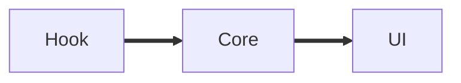

# Folio showcase: every element a reply can hold

This reply exists to be looked at. It walks through each piece of markdown the Folio draws, so one screen shows whether **bold**, *italic*, ***both***, ~~struck~~ and `inline code` sit well together in a paragraph, and whether a line can run long enough to wrap twice without the rhythm of the column breaking or the eye losing its place on the way back.

A second paragraph, with a link to [the Claude Code docs](https://docs.anthropic.com/en/docs/claude-code), a bare address https://horadric.dev, an angle link <https://github.com/anthropics/claude-code>, and a mail link [write to us](mailto:hello@horadric.dev).
This line follows a single newline, which the Folio keeps as a line break.
This one ends with two spaces for a hard break.  
And this one comes after it.

## Paths, code and keys

The parser turns paths into links: `crates/horadric-core/src/markdown.rs:163`, crates/horadric-ui/src/folio/transcript.rs:812, a lone `flow.rs`, and a Windows path `C:\Users\morte\Documents\Github\horadric.dev\Cargo.toml`. A path in bold: **crates/horadric-ui/src/folio/rich.rs:402**.

Press <kbd>Ctrl</kbd>+<kbd>Shift</kbd>+<kbd>P</kbd> to open the palette, <kbd>Esc</kbd> to close it, and <kbd>Ctrl</kbd>+<kbd>F</kbd> to find in the conversation.

### A third level heading

Text under a third level heading, short.

#### A fourth level heading

Text under a fourth level heading, shorter still.

## Lists

1. Read the parser first.
2. Then the flow, which lays blocks flat:
   - paragraphs become `Kind::Text`
   - code becomes `Kind::Code`
     - nested a third level deep
     - with a second item here
   - tables become `Kind::Table`
3. Last, the scene.
   A continuation line inside the third item.

   And a second paragraph inside it, after a blank line.
10. An item that jumps to ten, to check the marker column.

- A bullet with **bold** and a [link](https://example.com).
- A bullet holding a code block:

  ```rust
  let blocks = markdown::parse(reply);
  ```

- A bullet with a long line that has to wrap at least once, so the hanging indent shows whether the second line lines up under the first word or under the bullet.

### Task list

- [x] Parse task boxes
- [x] Draw a checked box
- [ ] Draw an unchecked box
- [ ] Nested tasks:
  - [x] a done child
  - [ ] an open child

### Terms

**Folio**
: Horadric's chat view of a Claude Code session.

**Stage**
: The one terminal window that shows a project's sessions as panes.

**Hireling**
: A subagent, drawn as a lane under the step that started it.

## Callouts

> [!NOTE]
> The Folio draws everything itself with Direct2D. There is no web view behind it.

> [!TIP]
> Hold <kbd>Alt</kbd> while scrolling to move faster.

> [!IMPORTANT]
> State comes from hook events, never from parsing terminal output.

> [!WARNING]
> Stopping every `horadric.exe` stops the one you are running inside.

> [!CAUTION]
> `git stash` in a shared checkout takes other agents' work with it.

## Quotes

> A plain quote, one paragraph, long enough to wrap once so the bar can be seen running the full height of the text beside it.
>
> A second paragraph in the same quote, with `code` and **bold**.
>
> > A quote inside the quote.
>
> - a list inside a quote
> - with a second item
>   - and a nested one

## Tables

| Crate | What it holds | Tests |
|---|---|---:|
| `horadric-core` | The pure logic, state, quests, merging | 1,284 |
| `horadric-ui` | Windows, tiles, the stage, the Folio | 312 |
| `horadric-pty` | The pseudo console and session hosts | 87 |
| `horadric-hooks` | Hook events and how they are read | 140 |

| Step | Status | Took |
|:---|:---:|---:|
| Build | ✅ passed | 41.2 s |
| Clippy | ⚠️ 3 warnings | 18.0 s |
| Tests | ❌ 2 failed | 2 min 4 s |
| Release | ⏳ waiting | |

| Left | Centre | Right | None |
|:-----|:------:|------:|------|
| a | b | 1 | x |
| longer text | middle | 22.50 | y |

| Field | Type | Default | Required | Since | Description | Example | Notes |
|---|---|---|---|---|---|---|---|
| `claude_session_id` | string | none | no | 0.4 | The Claude Code session this tile resumes | `9db48eda-15a5-4b55-bb00-ef79764fc85a` | Written once the first hook arrives |
| `chat` | bool | false | no | 0.9 | Whether the session is a Folio rather than a terminal | `true` | A Folio runs Claude headless |
| `running` | bool | true | yes | 0.1 | Whether the host should start the agent | `false` | Rested tiles keep their transcript |

## Code

A short one:

```bash
cargo check -p horadric-ui
```

A shell session with prompts and output:

```console
$ cargo test -p horadric-core markdown
   Compiling horadric-core v0.31.0
    Finished `test` profile [unoptimized + debuginfo] target(s) in 6.12s
     Running unittests src/lib.rs
test markdown::tests::table ... ok
test markdown::tests::nested_quote ... ok
test result: ok. 214 passed; 0 failed; 0 ignored
```

A diff:

```diff
--- a/crates/horadric-ui/src/folio/flow.rs
+++ b/crates/horadric-ui/src/folio/flow.rs
@@ -97,9 +97,10 @@ fn flatten(blocks: &[md::Block], indent: f32, quotes: u8, depth: usize, out: &mut Vec<Para>)
             md::Block::Heading { level, text } => {
                 let font = match level {
                     1 => Font::H1,
                     2 => Font::H2,
-                    _ => Font::H3,
+                    3 => Font::H3,
+                    _ => Font::H4,
                 };
```

With a title:

```rust title="crates/horadric-core/src/markdown.rs"
pub fn is_web_link(url: &str) -> bool {
    let b = url.as_bytes();
    let scheme = ["https://", "http://", "mailto:"]
        .iter()
        .any(|s| b.len() > s.len() && b[..s.len()].eq_ignore_ascii_case(s.as_bytes()));
    scheme && !url.chars().any(|c| c.is_whitespace() || c.is_control())
}
```

A long one, to check folding and line numbers:

```rust
use std::collections::HashMap;
use std::ops::Range;

/// A run of text and the styles over it.
#[derive(Debug, Clone, Default, PartialEq, Eq)]
pub struct Inline {
    pub text: String,
    pub spans: Vec<Span>,
}

#[derive(Debug, Clone, PartialEq, Eq)]
pub struct Span {
    pub range: Range<usize>,
    pub style: Style,
}

#[derive(Debug, Clone, PartialEq, Eq)]
pub enum Style {
    Bold,
    Italic,
    Strike,
    Code,
    Link(String),
    Path { path: String, line: Option<u32> },
}

impl Inline {
    /// The spans with their ranges in UTF-16 code units.
    pub fn utf16_spans(&self) -> Vec<(Range<u32>, &Style)> {
        let mut at = vec![0u32; self.text.len() + 1];
        let mut units = 0u32;
        for (i, c) in self.text.char_indices() {
            at[i] = units;
            units += c.len_utf16() as u32;
        }
        at[self.text.len()] = units;
        self.spans
            .iter()
            .map(|s| (at[s.range.start]..at[s.range.end], &s.style))
            .collect()
    }
}

fn count_styles(inl: &Inline) -> HashMap<String, usize> {
    let mut seen = HashMap::new();
    for s in &inl.spans {
        *seen.entry(format!("{:?}", s.style)).or_insert(0) += 1;
    }
    seen
}

#[cfg(test)]
mod tests {
    #[test]
    fn empty_has_no_spans() {
        assert!(super::Inline::default().spans.is_empty());
    }
}
```

A wide one, to check horizontal overflow:

```json
{"type":"assistant","message":{"role":"assistant","content":[{"type":"tool_use","id":"toolu_01ABCDEFGHIJKLMNOPQRSTUV","name":"Bash","input":{"command":"cargo test -p horadric-core markdown::tests::every_fixture_reply_parses","description":"Run the fixture parse test"}}]},"session_id":"9db48eda-15a5-4b55-bb00-ef79764fc85a"}
```

```powershell
Get-Process horadric | ? Path -like '*\target\*' | Stop-Process -Force
```

---

## Edges the parser does not know yet

Setext heading, level one
=========================

Setext heading, level two
-------------------------

A claim with a footnote[^1] and a reference style [link][docs].

[^1]: The footnote's own text, which belongs at the bottom.
[docs]: https://docs.anthropic.com

An image: 

Inline HTML: <b>bold by tag</b>, <sub>sub</sub>, a line<br>break, and an entity &amp; a non breaking&nbsp;space.

<details>
<summary>A folded section in HTML</summary>

What sits inside it.

</details>

    An indented code block, four spaces in.
    A second line of it.

Emoji in prose: 🚀 ✨ 🧪 and a flag 🇩🇰.

Inline math $E = mc^2$ and a display block:

$$
\sum_{i=1}^{n} i = \frac{n(n+1)}{2}
$$



A very long word with no break: crates/horadric-ui/src/folio/transcript.rs/averyveryveryveryveryveryveryveryveryveryveryveryveryveryverylongsegment.

Escapes: \*not italic\*, \`not code\`, \# not a heading.
